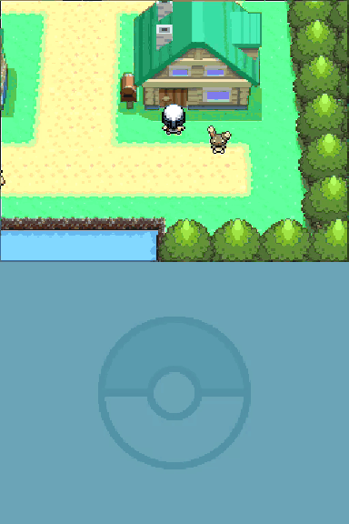

# Twinleaf Town

A browser rebuild of Twinleaf Town from Pokémon Diamond and Pearl, where every resident is a Fable 5.2 coding session.

[Watch the demo as MP4](docs/demo.mp4)

## Play

1. Clone this repository.
2. Open `game/index.html` in Chrome.

There is no build step and no dependency.

To serve it over HTTP instead, run `python3 serve.py` and open the address it prints. Do not use `python3 -m http.server`: the page asks for more than 100 scripts at once, that server drops some, and startup stops with "Startup blocked".

## Controls

| Key | Action |
| --- | --- |
| Arrows or WASD | Move |
| E, Z or Enter | Talk, continue, choose |
| X | Open or close the session list |
| B | Go back |
| Esc | Close a dialogue |

Hold E to make text print faster.

## What you can do

- **Give a helper a job.** Four Pokémon walk between the houses. Each one is a session with one job: fix the flaky test, build the feature, review the PR, write the report. Talk to one, choose the job, and keep walking.
- **Read the report.** Press X. The lower screen lists the four sessions, their status, and the last report.
- **Talk to the residents.** Eight people live in the town and its houses. Each one has something to say about being a Fable 5.2 session.

Every line is hardcoded. The game calls no model and sends nothing out of the browser.

## Change the lines

| What | Where |
| --- | --- |
| Helper names, jobs, greetings and reports | `houses` in `game/world.js` |
| Helper progress and done lines | `taskDialogView` in `game/world.js` |
| Resident lines | `messages[].tokens` in `game/dialogue-data.js` |

Resident lines use the game font and the original text box. A line holds 216 pixels, which is about 36 characters. A page holds two lines. Use `’` for an apostrophe, because the font has no straight quote.

## How it works

The game is plain JavaScript on one canvas. The canvas is 512 by 768 pixels and shows two stacked screens.

- `game/game.js` runs the loop, input, dialogue and the session list.
- `game/source-cpu-renderer.js` draws the town in software from the map data in `game/source-data.js`.
- `game/world.js` holds the helpers and their jobs.
- `game/original-dialogue.js` prints resident text one glyph at a time.

Art, fonts and sound data are embedded in the script files, so the folder works offline. The recording of the town theme is not included, so the music track is silent.

## Status

This is an unfinished fan project. The page itself says "fidelity incomplete". It covers the town and the inside of its houses. It is checked in Chromium only, and this repository has no automated tests.

## Credits

Pokémon, Twinleaf Town, and the game's art, maps, music and text belong to Nintendo, Game Freak and Creatures. This project is not affiliated with them or endorsed by them. It includes no ROM. No license is granted for the game's material.
